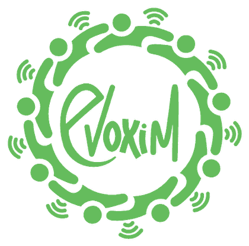
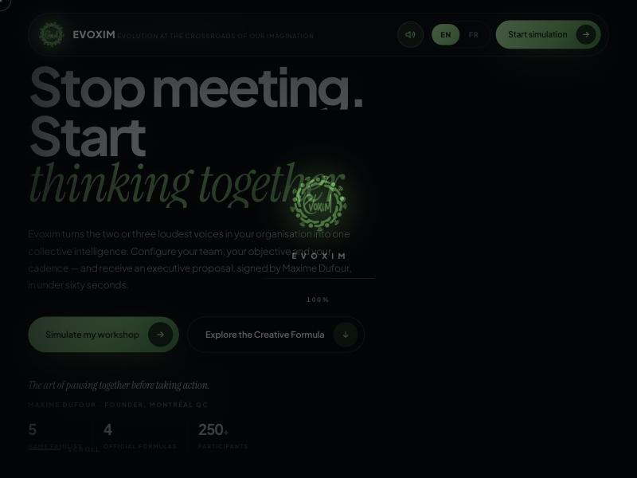
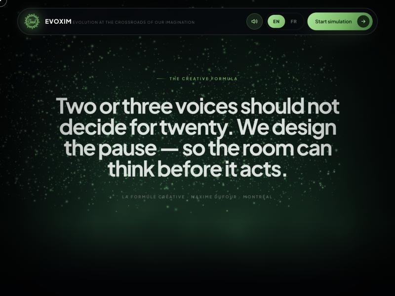
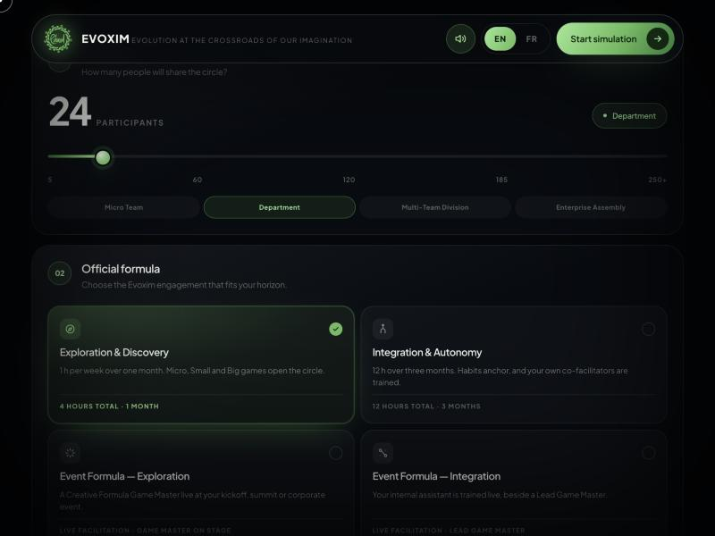
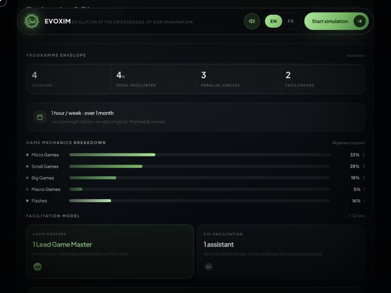
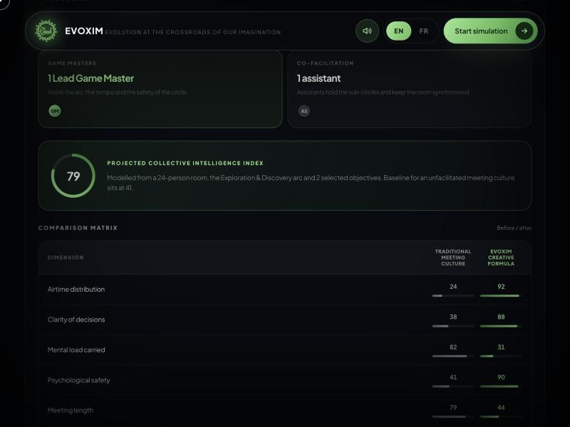

<p align="center">
  
</p>

<h1 align="center">Evoxim Interactive Studio</h1>

<p align="center">
  <strong>AI-powered client experience platform for collective communication</strong>
</p>

<p align="center">
  <a href="https://evoxim-interactive-studio.vercel.app">
    
  </a>
</p>

<p align="center">
  Built for <a href="https://evoxim.com">Evoxim Communication Collective</a> (Montreal, Canada)<br>
  A cinematic, interactive platform that turns Evoxim's facilitation services into a self-service digital experience.
</p>

---

## What It Does

Evoxim helps organizations fix broken meeting culture through game-based facilitation. This platform lets potential clients **configure their needs, see a live recommendation, and generate a branded PDF proposal** — all in under 60 seconds, without ever speaking to a sales rep.

### The Problem
Evoxim's founder Maxime Dufour runs workshops that transform how teams communicate. But explaining what a "Creative Formula" session looks like — and why it works — is hard to do on a static website.

### The Solution
An interactive simulator where clients experience the recommendation process themselves:

1. **Set team size** (5 to 250+ participants)
2. **Choose a formula** (Exploration, Integration, Event formats)
3. **Select objectives** (reduce mental load, unlock collective intelligence, etc.)
4. **Describe their situation** in free text
5. **Get an AI-generated recommendation** with programme structure, game mechanics breakdown, and a projected Collective Intelligence Index
6. **Download a branded PDF proposal** ready to share with their HR committee

---

## Screenshots

### Cinematic Hero with WebGL Particles

> 3D particle system built with Three.js and custom GLSL shaders. Particles morph between geometric shapes as the user scrolls.

### Scroll-Driven Manifesto

> GSAP ScrollTrigger reveals the Creative Formula philosophy with parallax text and particle animations.

### Interactive Configurator

> Multi-step configurator: team size slider, formula cards, priority objectives, experience type selection. Every choice dynamically updates the recommendation engine.

### Live Results Dashboard

> Real-time programme envelope: sessions, hours, parallel circles, facilitators. Game mechanics breakdown with percentage bars across 5 game families (Micro, Small, Big, Macro, Flashes).

### Collective Intelligence Index

> Projected CI score with before/after comparison matrix across 6 dimensions: airtime distribution, clarity of decisions, mental load, psychological safety, meeting length, and follow-through.

---

## Tech Stack

| Layer | Technology |
|-------|-----------|
| **3D Graphics** | Three.js r128, custom GLSL vertex/fragment shaders, WebGL |
| **Animation** | GSAP 3 + ScrollTrigger, CSS 3D perspective transforms |
| **Generative Art** | Canvas2D procedural generation (bloom, orbit, wave, shard, nebula) |
| **Recommendation Engine** | Deterministic rules-based matching (no external API calls) |
| **PDF Generation** | jsPDF client-side rendering with branded templates |
| **Internationalization** | Static i18n dictionary (EN/FR) with instant switching |
| **Audio** | Web Audio API for tactile interaction sounds |
| **State Management** | Single STATE object pattern with reactive updates |
| **Architecture** | Single-file HTML (~360KB, zero dependencies on build tools) |
| **Deployment** | Vercel (static) |
| **Backend** | FastAPI (Python) for lead storage and analytics |

## Architecture

```
index.html (360KB)          <- Main deliverable: everything in one file
  |-- Three.js WebGL        <- 3D particle morphing system
  |-- GSAP ScrollTrigger    <- Scroll-driven animations
  |-- Canvas2D GenArt        <- Procedural background art
  |-- Configurator UI        <- Multi-step form engine
  |-- Recommendation Engine  <- Deterministic service matcher
  |-- PDF Generator          <- jsPDF branded proposals
  |-- I18N System            <- EN/FR bilingual support
  |-- Web Audio              <- Tactile sound effects
  
backend/                     <- FastAPI REST API
  |-- leads                  <- Lead capture & storage
  |-- proposals              <- Proposal generation
  |-- analytics              <- Usage tracking
  |-- recommendation         <- Server-side matching

admin.html                   <- Admin dashboard (cinematic UI)
```

## Key Features

- **Zero Build Step** — Pure HTML/CSS/JS, no webpack/vite/npm required
- **Fully Bilingual** — EN/FR toggle switches all content instantly
- **Offline-Capable** — Recommendation engine runs entirely client-side
- **PDF Export** — One-click branded executive proposals
- **Responsive** — Works on desktop, tablet, and mobile
- **Cinematic UX** — WebGL particles, scroll animations, generative art, spatial audio
- **Privacy-First** — All computation happens in the browser, no data sent to third parties

## Getting Started

The main site is a single HTML file — just open it:

```bash
# Clone the repo
git clone https://github.com/Majeedkhan05/evoxim-interactive-studio.git

# Open in browser
open index.html

# Or serve locally
python3 -m http.server 8080
```

For the backend API:
```bash
cd backend
pip install -r requirements.txt
uvicorn app.main:app --reload
```

## Live Demo

**[https://evoxim-interactive-studio.vercel.app](https://evoxim-interactive-studio.vercel.app)**

---

<p align="center">
  Built by <a href="https://github.com/Majeedkhan05">Majeed Khan</a> for <a href="https://evoxim.com">Evoxim Communication Collective</a>
</p>
